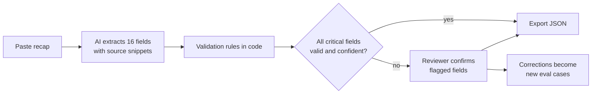

# Fixture Recap Parser

Turns a broker's free-text tanker fixture recap into structured, validated JSON, and shows a person exactly which terms to check before the data goes into a voyage management system.

Every fixture ends in a recap: an email or chat message confirming vessel, cargo, ports, laycan, freight, demurrage and the rest. Operators re-key those terms by hand into IMOS or an in-house VMS. That is slow, and a single mistyped laycan or demurrage rate flows straight into estimates, invoices and claims. This project tests whether an AI parser plus a short human review can be faster *and* at least as accurate as re-keying.

> **Status: week 2 of 4.** The schema, eval set, eval harness and rules-only baseline are done. The AI parser and its validation rules are built and tested offline. The first AI eval run starts once the API key secret is added (see [Run the AI eval](#run-the-ai-eval)). The hosted review page is next.

## How it works



The model extracts; deterministic code validates. The model is never the only check on a field that drives money or dates.

## What's in the repo

| Path | What it is |
| --- | --- |
| [`schema/fixture.schema.json`](schema/fixture.schema.json) | JSON Schema (2020-12) for the export: 16 fields, null when a term isn't stated |
| [`evals/recaps/`](evals/recaps) | 40 synthetic tanker recaps in five slices |
| [`evals/expected/`](evals/expected) | The correct answer for each recap, plus which fields must be flagged |
| [`evals/run_eval.py`](evals/run_eval.py) | Scores any parser's predictions against the expected answers |
| [`evals/results/`](evals/results) | One report per parser or prompt version, kept for comparison |
| [`baseline/rules_parser.py`](baseline/rules_parser.py) | Regex-only baseline the AI parser must beat |
| [`parser/`](parser) | The AI parser: [versioned prompt](parser/prompts/v1.md), [extraction](parser/extract.py), [validation rules](parser/validate.py), [batch runner](parser/run.py) |
| [`.github/workflows/eval.yml`](.github/workflows/eval.yml) | Runs the AI parser on the eval set and commits the report |
| [`tools/generate_samples.py`](tools/generate_samples.py) | Builds the eval set from structured fixtures (reproducible, seeded) |
| [`docs/`](docs) | [PRD](docs/PRD.md), [decision log](docs/decision-log.md), [port names](docs/ports.md) |

## The quality bar

| Metric | Target | Why it matters |
| --- | --- | --- |
| Field accuracy | ≥ 95% | Overall usefulness |
| Critical-field accuracy (vessel, charterer, cargo, ports, laycan, freight, demurrage, subjects) | ≥ 98% | These drive money and dates |
| Wrong and **not** flagged | ≤ 1% | A flagged error costs a few seconds of review. An unflagged one reaches an invoice. |
| Flag recall on missing or conflicting terms | 100% | The parser must say "I don't know" instead of guessing |

A prompt or model change ships only if it scores at or above the current version on the full set.

## First result: the rules-only baseline

| Slice | Recaps | Field accuracy | Critical-field accuracy |
| --- | --- | --- | --- |
| Clean product tanker (CPP) | 10 | 98.8% | 97.8% |
| Dirty tanker (crude, DPP) | 10 | 99.4% | 98.9% |
| Missing or conflicting terms | 7 | 97.3% | 95.2% |
| Messy email | 5 | 75.0% | 73.3% |
| Shorthand one-liners | 8 | 18.8% | 0.0% |
| **All** | **40** | **79.7%** | **75.0%** |

Regular expressions do well on neatly labelled recaps. They collapse on shorthand ("BLUE HERON II 55 JET A1 5% MOLCHOPT ..."). Worse, they silently pick one value when a recap contradicts itself, and nothing marks those values as doubtful. The baseline flagged only 40% of the terms it should have. Full report: [`evals/results/rules-baseline.md`](evals/results/rules-baseline.md).

A caveat on these numbers: the samples come from templates, so the clean slices are more regular than real broker traffic, and they flatter any parser. Adding anonymized real-world formats is on the roadmap.

## Run it

Python 3.10+. The eval harness, baseline and tests need no third-party packages. Only the AI parser needs the `anthropic` package (`requirements.txt`).

```bash
python3 tools/generate_samples.py                      # rebuild the eval set (deterministic)
python3 baseline/rules_parser.py evals/recaps out/baseline
python3 evals/run_eval.py --predictions out/baseline   # prints the report
python3 tests/test_eval.py                             # self-tests for the harness
python3 tests/test_parser.py                           # parser and validation tests (no API key needed)
```

To score your own parser, write one `<recap_id>.json` per recap in the format described at the top of [`run_eval.py`](evals/run_eval.py).

## Run the AI eval

The AI parser calls Claude through the Anthropic API, so it needs an API key from the [Claude Console](https://platform.claude.com/settings/keys). The key is never stored in the code.

**On GitHub (recommended).** Add the key once as a repository secret named `ANTHROPIC_API_KEY` (**Settings → Secrets and variables → Actions**). Then open **Actions → AI eval → Run workflow**. The workflow also runs on its own whenever `parser/` changes on `main`. It runs the offline tests, parses all 40 recaps, posts the report on the run page, and commits it to [`evals/results/`](evals/results).

**Locally.**

```bash
pip install -r requirements.txt
export ANTHROPIC_API_KEY=...            # from the Claude Console
python3 parser/run.py evals/recaps out/ai-v1
python3 evals/run_eval.py --predictions out/ai-v1
```

How the parser keeps errors visible:

- **One forced tool call.** The model has to answer through a tool whose schema is built from the export schema, so every response parses into the 16 fields.
- **Source words for every value.** Code checks that those words really appear in the recap. A value with invented or missing source words is marked low confidence.
- **Contradictions come back empty.** The prompt tells the model to return null and low confidence when a term is stated two different ways.
- **Rules have the last word.** Laycan order and window, IMO check digit, Worldscale range, freight currency, demurrage and cargo-quantity ranges are all checked in code. Any failure flags the field, whatever confidence the model gave.

## Roadmap

1. **Week 1 (done):** schema, 40-recap eval set, eval harness, rules baseline.
2. **Week 2 (built, awaiting first run):** AI extraction with a forced tool call and source snippets, plus the validation rules. First AI eval run.
3. **Week 3:** hosted review page: paste, review flagged fields, export JSON. Tune the prompt against the eval set.
4. **Week 4:** demo video, write-up, and real-world format samples.

## How this was built

I wrote the PRD and acceptance criteria and made the product decisions. The code was produced by directing AI coding tools (Claude), then reviewed and tested against the eval set. The [decision log](docs/decision-log.md) records what was decided and why, including where the AI's output was changed.

All vessels, companies, IMO numbers and figures in this repo are invented. Nothing here is a real commercial fixture.
