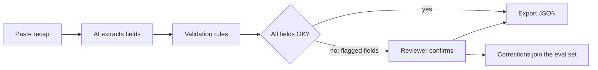

# Fixture Recap Parser: PRD

Author: Aditi Joshi · Last updated 16 Oct 2026 · Status: MVP in build

## Problem and context

Every fixture ends in a recap: a free-text email or chat message that confirms the agreed terms. Operators, charterers and accounts teams then re-key those terms by hand into a voyage management system such as IMOS or an in-house VMS.

Recaps are hard to parse with rules. Each broker formats them differently, uses heavy shorthand (CPP, WS 125, LAYCAN 12-14 NOV, DEM USD 28,500 PDPR), and often amends terms in follow-up messages. Re-keying is slow, and a single mistyped laycan, rate or demurrage figure flows straight into voyage estimates, invoicing and claims.

The Fixture Recap Parser turns a pasted recap into structured, validated fixture data. It shows how confident it is in each field and asks a person to confirm anything uncertain before export.

## Goals, non-goals and success metrics

The MVP proves one thing: an AI parser plus a short human review is faster than re-keying a recap by hand, and at least as accurate.

**Goals**

- Extract the core fixture terms from a tanker recap (crude, DPP or CPP) in under 10 seconds.
- Flag every field the model is unsure of, or that fails a validation rule, so nothing uncertain is exported silently.
- Export clean JSON that follows a published, generic JSON Schema.

**Non-goals for the MVP**

- Dry-bulk recaps (a later release).
- Reading attachments, scanned PDFs or full charter party forms.
- Merging a chain of amendment emails into one final recap (a later release).
- Direct integration with IMOS or any live VMS, or an IMOS-specific export format.
- Storing real commercial recaps; the MVP runs on synthetic or anonymized samples only.

**Success metrics**

| Metric | MVP target | How measured |
| --- | --- | --- |
| Field-level accuracy on the eval set | 95% or higher | Exact or normalized match against expected output |
| Critical-field accuracy | 98% or higher | Same, critical fields only |
| Wrong values not flagged | 1% or lower | Wrong values marked high confidence |
| Time from paste to reviewed export | Under 2 minutes | Timed test on 10 recaps vs. manual re-keying |

## Users and core workflow

The primary user is the post-fixture operator, who has to get a new fixture into the voyage system quickly and correctly.

| User | What they need from the parser |
| --- | --- |
| Post-fixture operator (primary) | Fixture terms in the VMS within minutes, with nothing mistyped |
| Chartering manager | A quick check that the recap matches what was agreed |
| Accounts / claims | Correct demurrage, commission and payment terms from day one |

A recap that passes every check exports directly. Anything flagged goes to a person, and each correction becomes a new test case.

## Data model

The MVP extracts 16 fields. Critical fields drive money and dates, so they carry the strictest accuracy target and are always shown first in review. The export contract is [`schema/fixture.schema.json`](../schema/fixture.schema.json).

| Field | Example | Type / normalization | Critical |
| --- | --- | --- | --- |
| Vessel name | MT AEGEAN CREST | Text, prefix (MT/MV) split out | Yes |
| IMO number | 9596595 | 7 digits, check digit validated | No |
| Charterer | ACME ENERGY TRADING SA | Text | Yes |
| Owner / disponent owner | FJELLSTAD TANKERS AS | Text | No |
| Cargo | 80,000 MT CPP (ULSD) 10% MOLOO | Grade + quantity (MT) + tolerance + option | Yes |
| Load port(s) | 1/2 SP USG | List of canonical port or area names ([ports](ports.md)) | Yes |
| Discharge port(s) | 1/2 SP UKC-MED | List of canonical port or area names | Yes |
| Laycan | 12-14 NOV | Start and end date (ISO), year inferred from fixture date | Yes |
| Freight | WS 125 / USD 1.2M LS | Basis (WS, lump sum, per MT) + value + currency | Yes |
| Demurrage | USD 28,500 PDPR | Rate per day, currency, pro rata flag | Yes |
| Laytime | 72 HRS SHINC | Hours + terms | No |
| Commission | 2.5% ADDCOMM + 1.25% BROKERAGE | List of type + percent | No |
| Charter party form | ASBATANKVOY | Text | No |
| Subjects | SUBS LIFTED | ON_SUBJECTS or FIXED_CLEAN | Yes |
| Fixture date | 10 NOV 2026 | ISO date | No |
| Special clauses | WAR RISK FOR CHRTS ACCT | Free text, kept verbatim | No |

Each extracted field also carries the source text it came from, a confidence level (high, medium, low) and any validation messages.

## Functional requirements and AI behavior

The model extracts; deterministic code validates. The model is never the only check on a critical field.

**Input and output**

- FR1. Accept a pasted recap of up to 10,000 characters, in plain text or email body.
- FR2. Return every field in the data model, with null for anything not stated, never a guessed value.
- FR3. Export the reviewed result as JSON that validates against the published schema, with fields in data-model order.

**AI extraction**

- FR4. Use an LLM call with a fixed JSON schema (structured output), so responses always parse.
- FR5. For each field, return the exact source snippet it was taken from; a value with no snippet is marked low confidence.
- FR6. Expand common shorthand (SHINC, PDPR, MOLOO, WS, LS, SP, UKC) and keep the original text alongside.
- FR7. Version the prompt and schema; every result records which version produced it.

**Validation rules (code, not AI)**

- FR8. Laycan start is on or before laycan end, and within 120 days of the fixture date.
- FR9. IMO number passes the check-digit rule.
- FR10. Freight basis and value agree (a WS rate is a number between 1 and 500; a lump sum has a currency).
- FR11. Demurrage is a positive number with a currency.
- FR12. Any rule failure flags the field, regardless of the model's confidence.

**Review and audit**

- FR13. Show flagged fields first, with the source snippet highlighted in the original recap.
- FR14. The reviewer can accept, edit or clear any field; edits are logged with old value, new value and time.
- FR15. Export is blocked until every critical field is either high confidence and valid, or confirmed by a person.

## Evaluation plan and quality bar

A prompt or model change ships only if it scores at or above the current version on the full eval set.

| Slice | Count | What it tests |
| --- | --- | --- |
| Clean product tanker recaps (CPP) | 10 | Baseline accuracy on the most common format |
| Dirty tanker recaps (crude, DPP) | 10 | Different cargo grades, heating and freight conventions |
| Heavy shorthand, one-line style | 8 | Abbreviation handling |
| Missing or conflicting terms | 7 | Returns null and flags, never invents |
| Messy email (signatures, forwarded threads) | 5 | Ignores noise outside the recap |

- Recaps are synthetic, modelled on real formats, with invented vessels, parties and figures. No real commercial recap is stored.
- Each recap has an expected JSON. Dates, numbers and port names are compared after normalization.
- [`evals/run_eval.py`](../evals/run_eval.py) runs the whole set and reports field-level and critical-field accuracy, plus every wrong value marked high confidence.
- Results for each prompt version are kept in [`evals/results/`](../evals/results), so progress is visible over time.

## First user stories

**US-1. Paste and parse a recap.** As a post-fixture operator, I want to paste a recap and see its terms as structured fields, so that I don't re-key them by hand.

- Given a recap under 10,000 characters, when I select Parse, then all 16 fields appear within 10 seconds.
- Fields not stated in the recap show as empty, not guessed.
- Input over the limit shows an error that states the limit.

**US-2. See where each value came from.** As an operator, I want each field linked to its source text, so that I can check it at a glance.

- Selecting a field highlights its snippet in the original recap.
- A field with no source snippet is marked low confidence.

**US-3. Flag uncertain or invalid fields.** As an operator, I want uncertain and invalid fields flagged first, so that I spend my review time where it matters.

- Fields with medium or low confidence, or that fail a validation rule (FR8 to FR11), are flagged.
- Flagged fields are listed before the rest, critical fields first.
- Each flag states the reason, for example "Laycan end is before laycan start".

**US-4. Correct and confirm fields.** As an operator, I want to accept, edit or clear any field, so that the export reflects the agreed terms.

- An edited field re-runs its validation rule immediately.
- Every change is logged with old value, new value and time.

**US-5. Export the fixture.** As an operator, I want to export the reviewed fixture as JSON, so that I can load it into a voyage system.

- Export is disabled until every critical field is valid and either high confidence or confirmed.
- The JSON validates against the published schema and lists fields in data-model order.

**US-6. Measure accuracy on the eval set.** As the product owner, I want a one-command accuracy report, so that I can decide whether a prompt change is safe to ship.

- The report shows field-level and critical-field accuracy and lists wrong values marked high confidence.
- The report records the prompt version and the date it was run.

## Risks, decisions and milestones

The biggest risk is a confidently wrong value on a critical field. The design answers it with source snippets, code-based validation and a review gate.

| Risk | Mitigation |
| --- | --- |
| Model invents a value not in the recap | Require a source snippet per field; no snippet means low confidence |
| Confidently wrong critical field | Code validation on every critical field; track "wrong but high confidence" as its own metric |
| Formats vary more than the eval set covers | Every reviewer correction becomes a new eval case |
| Commercial data confidentiality | Synthetic data only in the MVP; no recaps stored server-side |
| Laycan year is ambiguous near year-end | Infer from fixture date; flag when the laycan month is earlier than the fixture month |

Decisions are recorded in the [decision log](decision-log.md).

**Milestones**

1. Week 1 (done): schema, 40 synthetic recaps with expected outputs, eval script (US-6), rules-only baseline.
2. Week 2: AI extraction and validation rules (US-1 to US-3); first AI eval run.
3. Week 3: hosted review page (US-4, US-5); tune the prompt against the eval set.
4. Week 4: README, decision log and a 3-minute demo video; publish the hosted demo page.
